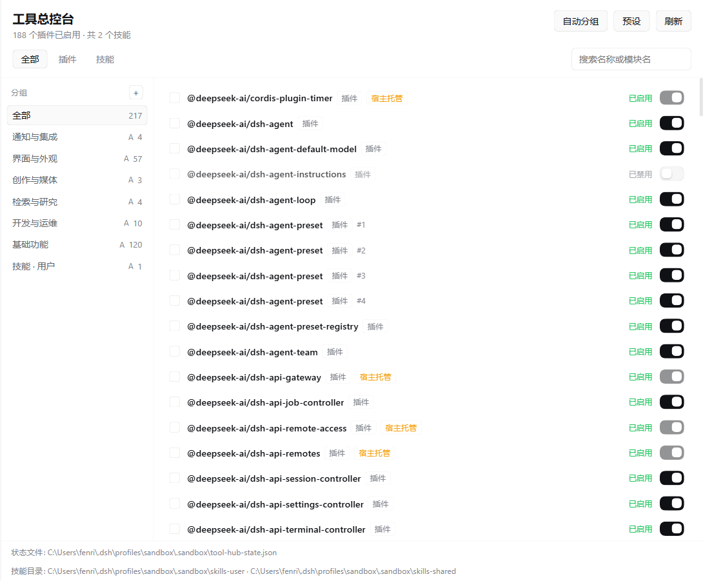
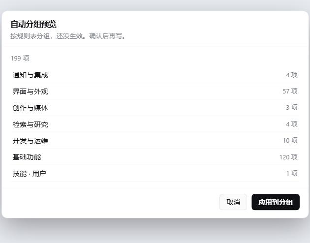

[English](README.md) · **简体中文**

# dsh-tool-hub 工具总控台

一个面板，把一套 DSH 安装里真正在跑的**插件**和**技能**列出来：逐项开关、按分组整组开关、
把「当前开着的这一套」存成预设。入口有两个——插件页的**总控台**标签页，以及侧边栏独立面板。






## 为什么做

关一个插件通常要翻 profile 的 patch 文件，关一个技能要手改 `SKILL.md` 的文件名。而「写论文要哪
些、写代码要哪些」这类问题，每换一套配置就要重新想一遍。总控台把这件事变成一个带开关、分组和
预设的列表。

## 安装

```bash
dsh plugin install FenrirCait/dsh-tool-hub
# 或者本地目录
dsh plugin install ./dsh-tool-hub
```

装完打开**插件 → 总控台**，或侧边栏的**工具总控台**。不需要重启，插件热加载。

## 能做什么

- **一个列表**：loader 里的每一条 + 用户技能目录里的每个技能。每行写明类型、是否开启、不能开关
  的原因。
- **逐项开关**：插件走宿主自己的 pluginManager，写进 profile patch，与插件页写的是同一处；技能靠
  重命名 `SKILL.md` ↔ `SKILL.md.disabled`。
- **分组**：新建、改名、删除、把当前勾选加入分组，整组一键启停。成员超过 20 个先确认。
- **自动分组**：按规则表一键分组（基础功能 / 界面与外观 / 创作与媒体 / 检索与研究 / 开发与运维 /
  通知与集成 / 技能），先预览再写。应用时只替换上一次的自动分组，手建的分组不动。
- **预设**：把当前状态存成预设，之后一键应用。`应用`会打开预设列出的、关掉没列的；`只开启`不关
  任何东西。改动大时先确认。

分组与预设全部只写一个文件：

```
<DSH_HOME>/tool-hub/state.json      # 默认 ~/.dsh/tool-hub/state.json
```

写入是原子的（临时文件 + rename），保存中途崩掉不会留下半截状态。

## 不做什么

- **暂不管理 MCP**：MCP 有自己的配置块，是下一版的目标。
- **不扫描用户技能根之外的技能**：只看 `~/.dsh/skills` 与 `~/.agents/skills`。项目级
  `.dsh/skills` 属于某个工作区而不是某套安装，列进来会误导。
- **宿主托管的条目**（插件管理器本身、定时器、工具注册表等）会显示但不可开关。宿主把它们标成
  `management-required` 或 `unaddressable`，行内直接说明，而不是藏起来。
- **没有终端界面**：这是 Web / Desktop 扩展。

## 开关到底改了什么

| 类型 | 机制 | 落在哪 |
| --- | --- | --- |
| 插件 | `pluginManager.setPluginEnabled(entryId, enabled)` | profile 的 patch 文件 |
| 技能 | 重命名 `SKILL.md` → `SKILL.md.disabled`（可逆） | 技能目录 |

两者都能从同一行改回来。插件开关可能返回 `restart-required`、`overridden`、`failed`，面板照实
报告宿主的回答，不假定成功。

### 在一次性 profile 里试

默认情况下分组和预设存在 `<DSH_HOME>/tool-hub/state.json`，技能开关落在 `<DSH_HOME>/skills` 与
`~/.agents/skills`。测试 profile 通常两边都不想要，两个环境变量可以把它们指到无害的地方：

```bash
TOOL_HUB_STATE_FILE=<目录>/tool-hub-state.json     # 分组、预设、自动分组记录
TOOL_HUB_SKILL_ROOTS=<目录>/skills;<目录>/skills2  # 技能根，Windows 下用 ; 分隔
```

两个都设上，沙盒里试「整组禁用」就只动沙盒。

## 开发

```
lib/index.js         宿主部分：snapshot、各类 op、HTTP 路由（/tool-hub/api/*）
client/client.js     客户端部分：一个手写的 ModuleLoader bundle，只依赖 React
locale/{zh,en}.json  插件页显示的元数据
cordis.patch.yml     bundle 的 insert
probe/host-smoke.mjs 26 条断言，跑在临时 DSH_HOME + 假 pluginManager 上
```

```bash
node --check lib/index.js
node --check client/client.js
node probe/host-smoke.mjs
```

HTTP 只有两条 exact 路由：`GET /tool-hub/api/snapshot` 与 `POST /tool-hub/api/op`，用与内置市场
同款同源校验。

## 许可

MIT
